# WhatsApp Sandbox

A browser-based playground for **WhatsApp Flows**. Three phones — **Sender**, **Traveler** and **Receiver** — share one WhatsApp group chat, and you can build, validate, publish and run Flows between them without a WhatsApp Business account.

Built with Next.js, React, TypeScript, Tailwind CSS and Framer Motion. Everything runs locally in the browser: there is no real WhatsApp, Graph API or backend involved.

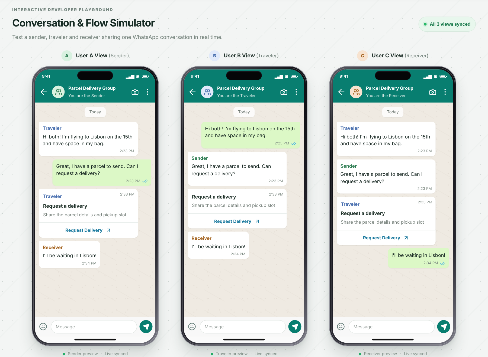

## Contents

- [Quick start](#quick-start)
- [The three phones](#the-three-phones)
- [Running a Flow](#running-a-flow)
- [Flow Studio](#flow-studio)
- [Supported Flow JSON features](#supported-flow-json-features)
- [Sample flows](#sample-flows)
- [Project structure](#project-structure)
- [Limitations](#limitations)

## Quick start

Requires Node.js 20.9 or newer.

```bash
npm install
npm run dev
```

Open [http://localhost:3000](http://localhost:3000).

Other scripts: `npm run build` (production build) and `npm run start` (serve the build).

## The three phones

The scenario is a parcel delivery: a **Sender** wants something delivered, a **Traveler** carries it, and a **Receiver** collects it.

- Every phone shows the same group chat (**Parcel Delivery Group**) and can send messages; incoming bubbles carry the author's role name.
- A Flow message in the chat opens a bottom sheet **inside the phone that tapped it**, so each phone runs its own Flow session.
- When someone finishes a Flow, their answers are posted back into the chat as a response message.
- The floating **Integration Triggered** panel shows the latest mock backend event (messages, Flow messages, Flow completions, Graph API and webhook payloads). **Export JSON** downloads the whole conversation, flows, events and endpoint log; **Reset demo** restores the starting state.

## Running a Flow

Tap the button on a Flow message (for example **Request Delivery**) to open the Flow. The sheet follows the real WhatsApp layout: floating labels, "(optional)" hints, character counters, and a Footer button that stays disabled until the form is valid.

| Customer feedback — screen 1 | Customer feedback — screen 2 | Endpoint-powered Delivery request |
| --- | --- | --- |
| 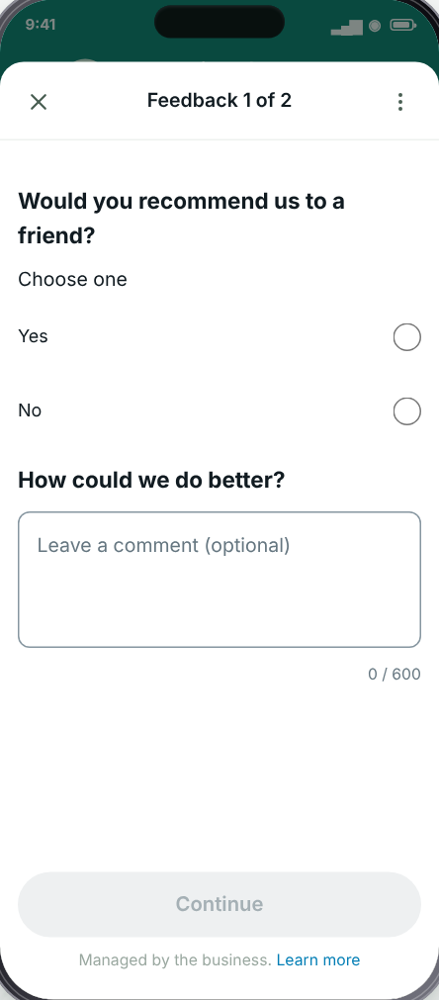 | 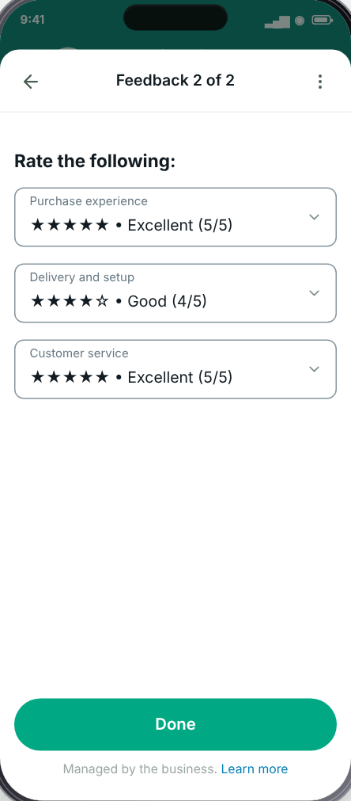 | 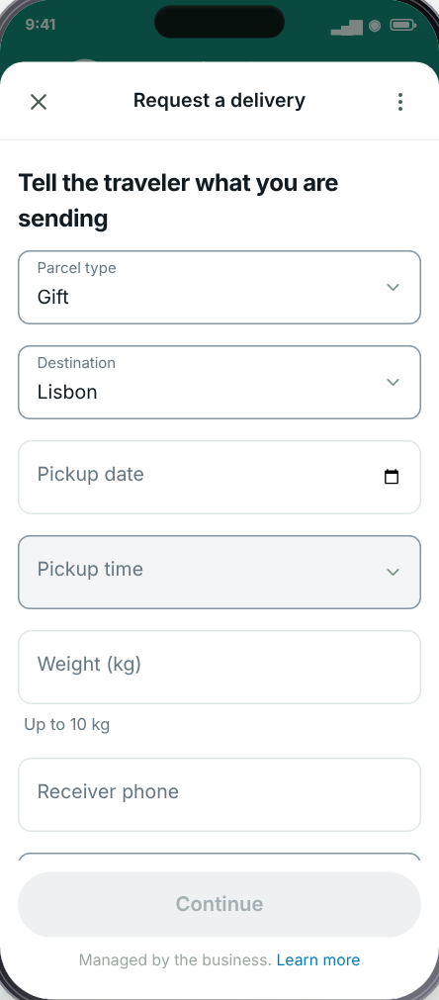 |

The Delivery request Flow uses the mock **Flow endpoint**: opening it sends an `INIT` request, and choosing a parcel type or destination sends `data_exchange` requests that enable the next dropdowns.

When a Flow completes, the response lands in the chat and the matching webhook payload (`interactive.nfm_reply`) is logged:

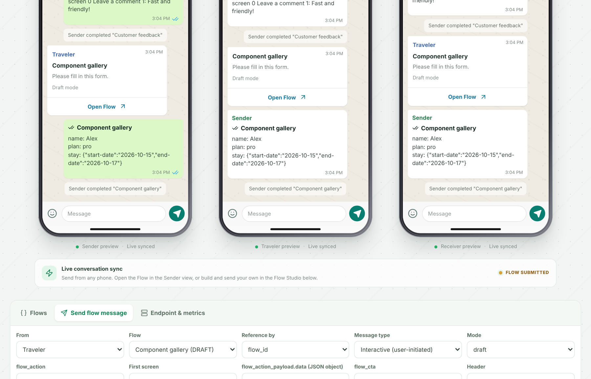

### Component gallery

The **Component gallery** flow (draft) exercises most of the component set across five screens.

| Text & inputs | Choices, If & Switch | Dates & CalendarPicker | Media upload |
| --- | --- | --- | --- |
| 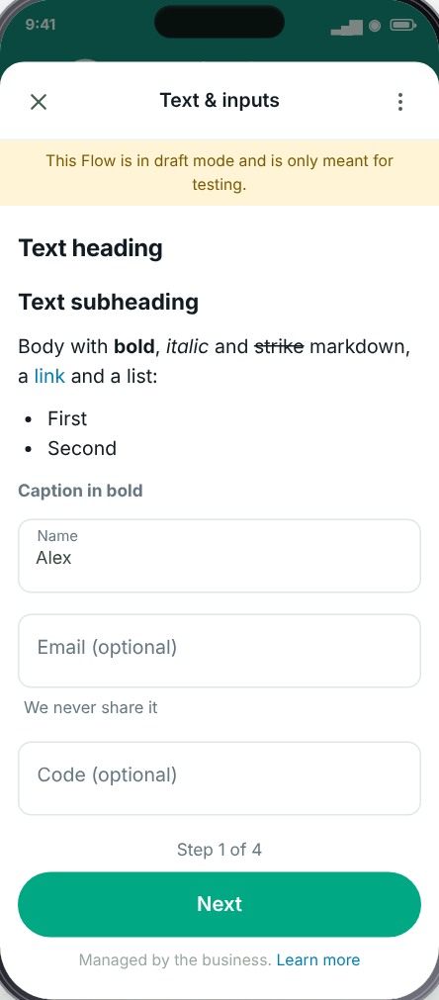 | 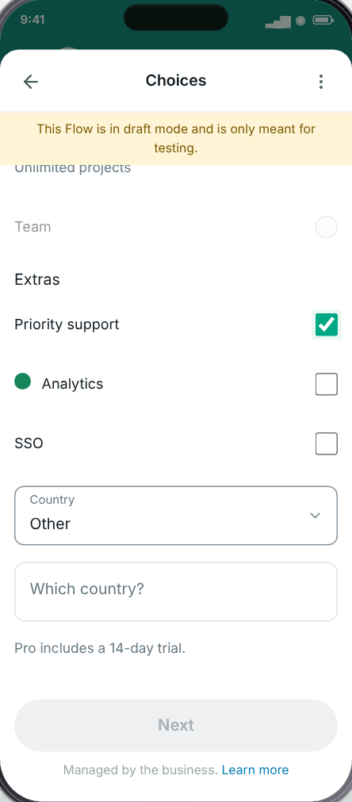 | 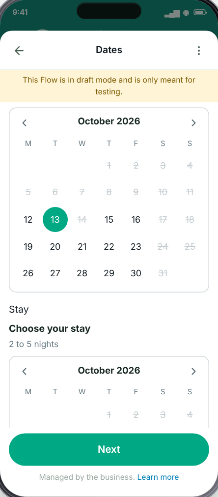 | 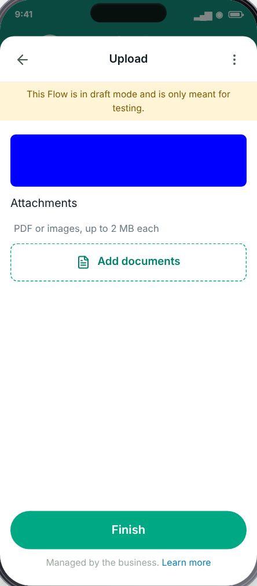 |

## Flow Studio

The **Flow Studio** below the phones has three tabs.

### Flows

Create, edit, save, publish, deprecate, duplicate and delete Flows. The JSON editor validates as you type, and publishing is gated by the documented publishing checks.

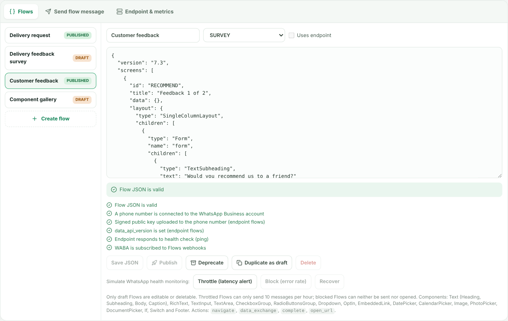

- **Lifecycle:** `DRAFT` → `PUBLISHED` → `DEPRECATED`, plus system states `THROTTLED` (10 messages per hour) and `BLOCKED` (cannot be sent or opened). Only drafts can be edited or deleted.
- **Health simulator:** throttle, block and recover a published Flow. Each change logs a `FLOW_STATUS_CHANGE` webhook payload.

### Send flow message

Send a Flow from any phone, using either an interactive message or a template message with a Flow button. You can set `flow_id` or `flow_name`, `mode` (draft or published), `flow_action` (`navigate` or `data_exchange`), the first screen, `flow_action_payload.data`, `flow_cta`, header, body, footer and `flow_token`. The Cloud API request body is shown live.

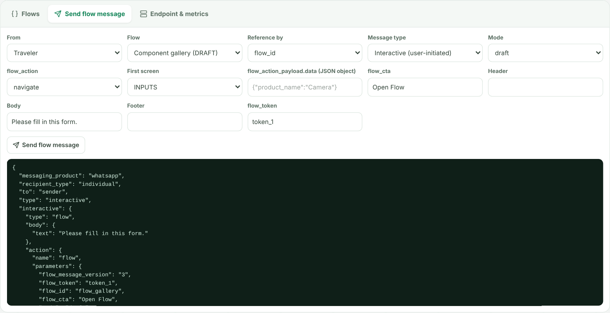

### Endpoint & metrics

Turn the mock endpoint on or off to simulate outages, send a health check (`ping`), toggle the publishing prerequisites (phone number, public key, webhooks) and inspect every request and response. Request count, errors, error rate, latency and availability are computed from the log.

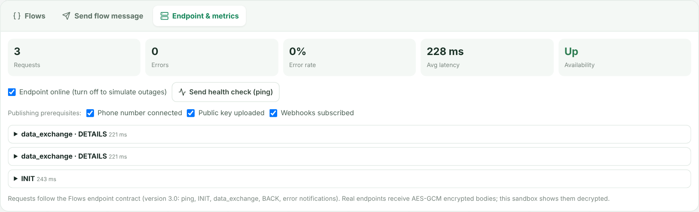

## Supported Flow JSON features

Implemented from the WhatsApp Flows documentation and the samples in [WhatsApp/WhatsApp-Flows-Tools](https://github.com/WhatsApp/WhatsApp-Flows-Tools).

**Components**

- Text: `TextHeading`, `TextSubheading`, `TextBody`, `TextCaption` (with `font-weight`, `strikethrough`, `markdown`), `RichText` (headings, lists, tables, images, links)
- Inputs: `TextInput` (text, number, email, phone, password, passcode, `pattern`, `min-chars`, `max-chars`), `TextArea`, `Dropdown`, `RadioButtonsGroup`, `CheckboxGroup` (descriptions, metadata, images, colors, `enabled`), `OptIn`
- Dates: `DatePicker` (timestamps before 5.0, `YYYY-MM-DD` from 5.0), `CalendarPicker` (single and range, min/max, unavailable dates, `include-days`, `min-days`, `max-days`)
- Media: `Image`, `PhotoPicker`, `DocumentPicker`
- Layout and navigation: `Form`, `If`, `Switch`, `EmbeddedLink`, `Footer` (left, center and right captions)

**Actions and data**

- Actions: `navigate`, `data_exchange`, `complete`, `open_url`, `on-select-action`
- References: `${form.x}`, `${data.x}` and global `${screen.ID.form.x}` / `${screen.ID.data.x}`
- Component properties: `init-value`, Form `init-values`, `error-message(s)`, `visible`, `enabled`, `required`, dynamic `data-source`
- Screen properties: `terminal`, `success`, `refresh_on_back`, `sensitive` (masked in the response summary)
- `If` conditions support `!`, `&&`, `||`, `==`, `!=`, `>`, `>=`, `<`, `<=` and parentheses

**Endpoint (version 3.0)**

`ping`, `INIT`, `data_exchange`, `BACK`, error notifications, `flow_token`, and `extension_message_response` to end the Flow.

**Validator**

Checks the documented rules: character and option limits, 50 components per screen, image/link/opt-in counts, version gating (for example RichText 5.1, CalendarPicker 6.1, `pattern` 6.2, `open_url` 6.0), If/Switch rules, media-picker rules, routing model, terminal screens and the reserved `SUCCESS` screen id.

## Sample flows

| Flow | Version | Status | Highlights |
| --- | --- | --- | --- |
| Delivery request | 7.2 | Published | Endpoint-powered, dependent dropdowns, `DatePicker`, phone/number inputs, `OptIn` |
| Customer feedback | 7.3 | Published | Radio buttons, optional text area, star-rating dropdowns across two screens |
| Delivery feedback survey | 7.2 | Draft | `RadioButtonsGroup`, `CheckboxGroup` limits, `complete` payload |
| Component gallery | 7.3 | Draft | Markdown, `RichText`, `If`/`Switch`, `CalendarPicker`, `DocumentPicker`, `sensitive` |

You can paste any Flow JSON into the Studio editor, for example one exported from the WhatsApp Flow Builder.

## Project structure

```text
app/
  page.tsx            Three phones, chat state, event log, Flow message handling
  globals.css         Styling (phones, chat, Flow sheet, Studio)
components/
  FlowRuntime.tsx     Renders and runs a Flow inside a phone
  FlowStudio.tsx      Flow management, message sending, endpoint and metrics
  Calendar.tsx        CalendarPicker widget
  Markdown.tsx        Markdown subset for RichText / TextBody / TextCaption
lib/flow/
  types.ts            Flow JSON, endpoint and message types
  engine.ts           Reference resolution and the mock endpoint
  expr.ts             `If` condition evaluator
  expand.ts           If/Switch expansion
  validate.ts         Flow JSON validator
  flows.ts            Sample flows
  samples/            Sample Flow JSON files
docs/images/          Screenshots used in this README
```

## Limitations

- Front-end simulation only: it does not connect to WhatsApp, the Graph API or a real endpoint. Studio actions are simulated and logged.
- Endpoint payloads are shown decrypted; real AES/RSA payload encryption and WhatsApp CDN media encryption are not implemented.
- `PhotoPicker` and `DocumentPicker` use the browser file chooser and nothing is uploaded.
- Components or properties that are not in the documentation used for this project are not supported.
